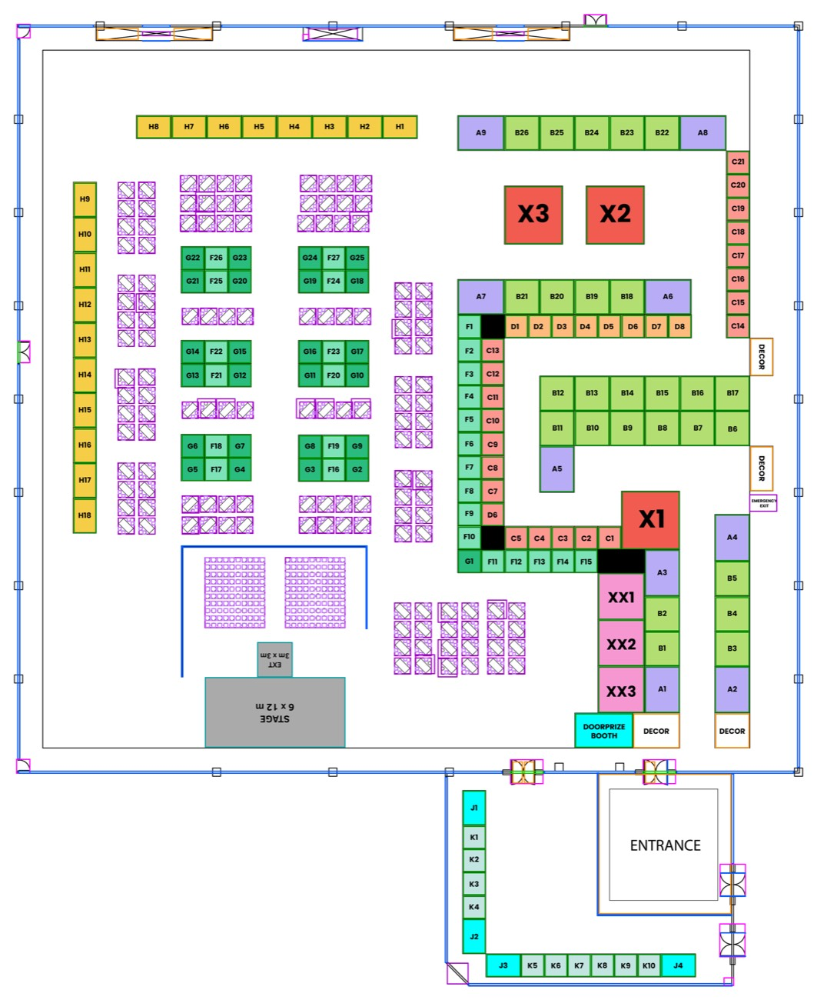
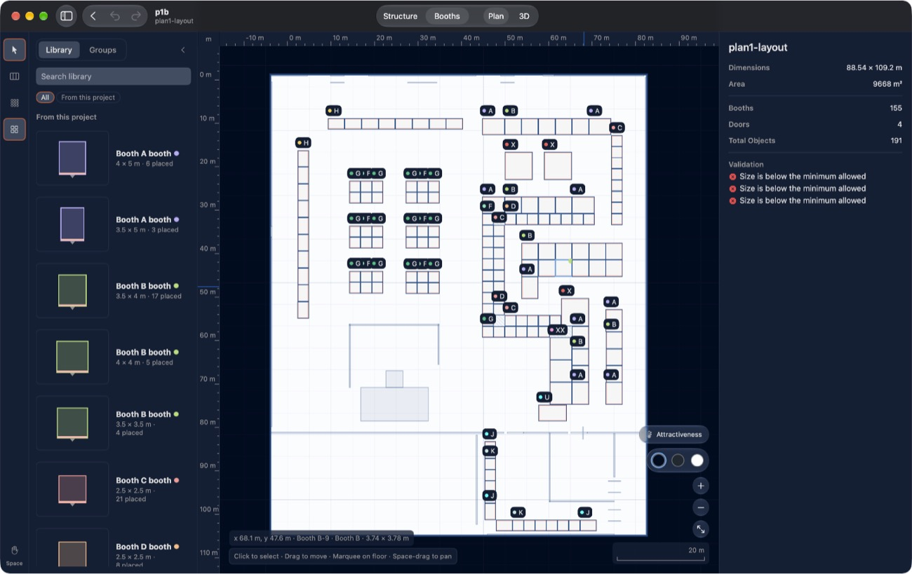
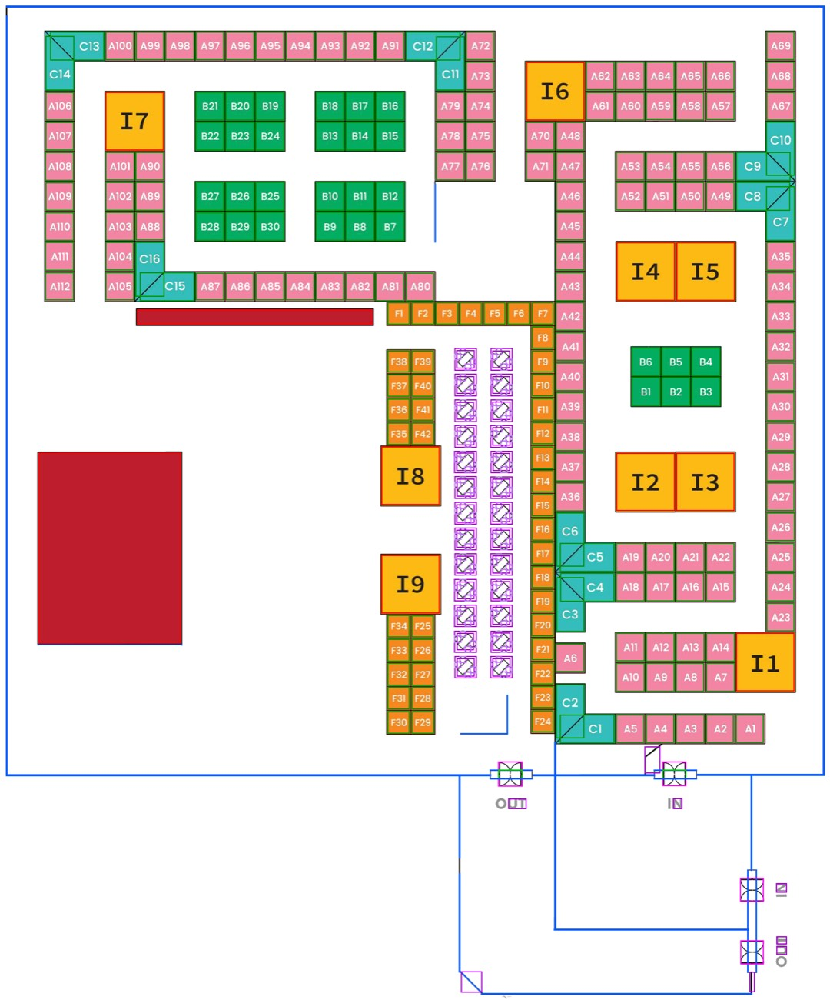
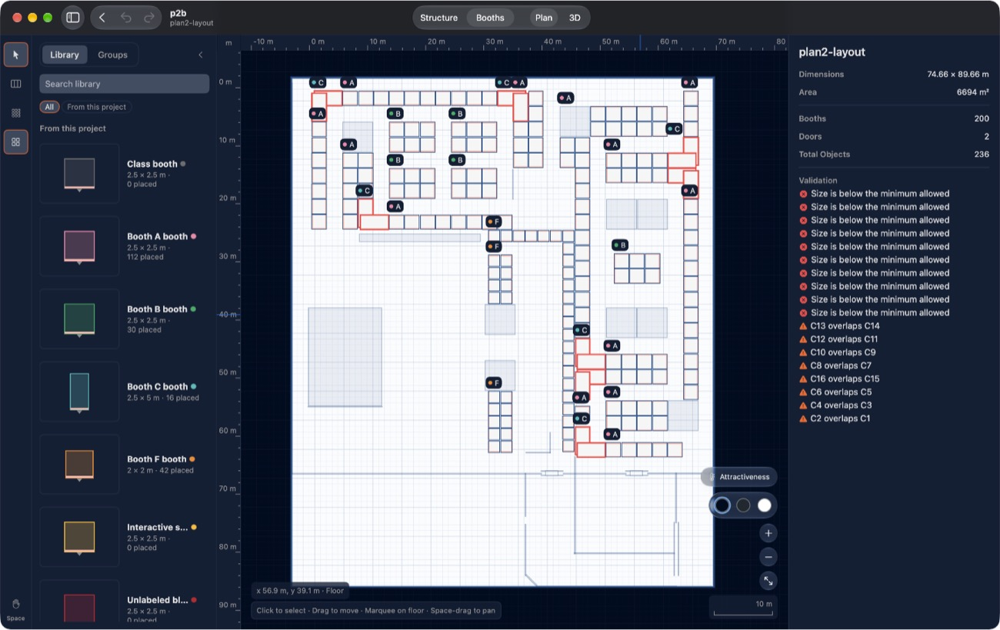

# Extractor evaluation on Plan 1 and Plan 2

Date: 2026-11-07. Branch: claude/editor-ui-ux-review-c2571c. Extractor package: `../bazaar/floor-plan-extractor/legend-only`.

## What was run

Plan 1 and Plan 2 from `Core/Resources/MockData/Extractor` were imported through the real pipeline (`ImportQueue`, `PDFImportService`, `ExtractorFloorPlanReader`, `ExtractedLayoutMapper`) and opened in the editor. The two plans have different legends, so each plan was read against its own legend. A third run put both legends and both plans in one project, to see what the app does with that.

No truth file was used. Every judgement below comes from the editor screen, the source image, and a dump of the raw extractor items drawn on the source image.

Caveats. The importer only accepts PDFs, so the PNGs were converted to single-page PDFs first. The runs used a Release build with the app sandbox switched off on the command line only, because a Debug build had not finished Plan 1 after ten minutes and Release took about 20 seconds. Temporary launch hooks were used to drive the import and were reverted. The opened editor menus and the 3D view were not looked at.

## What happened

The extractor itself did well. For Plan 1 it returned 1225 items: 155 booths with IDs and colours, 136 tables, 733 chairs, 138 chair groups, 27 walls, 3 blocked cells, the stage and the extension box, and the door symbols. For Plan 2 it returned 404 items: 200 booths, 26 tables, 104 chairs, 23 walls, 9 interactive blocks, 2 unlabeled blocks and the door symbols.

The editor shows much less. Plan 1 lands as 191 objects (155 booths, 27 walls, 4 doors, 3 blocked areas, 2 blocks). Plan 2 lands as 236 objects (200 booths, 23 walls, 11 blocks, 2 doors). Every table and chair is gone, most doors are gone, and the scale is wrong. Most of the loss is in the mapper, not in the reading.

## Failure modes

1. Tables and chairs are dropped. `classObject` in `ExtractedLayoutMapper.swift` returns nil for `object`, so 1012 items on Plan 1 and 164 on Plan 2 never reach the layout. The layout model has no kind for furniture, so the mapper has nowhere to put them.
2. Doors are mostly dropped. The extractor emits two door classes. `door` is a swing symbol, flagged for review. `opening` is a gap in a wall band under a swing symbol (`DoorLayer.swift`). The mapper keeps only `opening`. Plan 1 has 10 `door` and 4 `opening` items and the editor shows 4 doors. Plan 2 has 4 and 2 and the editor shows 2. The two gates on the vertical lobby wall are missing in both plans, because no `opening` was produced for them. Why is not traced.
3. Near-white classes are confused. Plan 1 draws DECOR boxes, the ENTRANCE frame and three X-crossed window frames. All of them come back as class `Entrance`, and the mapper drops `Entrance`. The extractor warned that Entrance and Decor are 0.0 apart in colour (`Legend.swift`), but the warning only goes to stdout and the app never shows it. The same goes for "Blocked is nearly black".
4. The scale is a guess. The mapper takes the median booth as 2.5 m. Plan 1 prints its stage as 6 x 12 m, and the stage box is 394 x 197 px, which is 32.8 px/m. The mapper used 25.4 px/m, so the stage shows as about 15.5 x 7.8 m and the whole plan is about 29 percent too large (88.5 x 109.2 m). Plan 2 prints no sizes, so its scale cannot be checked from the sheet.
5. The legend reader adds a row that is not a class. Plan 2 gets "Class", which is the table header. The reader treats any recognised text line with a swatch-like patch to its left as a class, and the "Symbol" header text sits to the left of "Class". This is the likely cause and was not verified. Plan 1 gets "Decor" as a booth category that nothing is placed in.
6. Two legends in one project break the second plan. `ImportQueue.readPlan` uses the first read legend page for every plan, while `legend(for:)` merges the entries of all legends. In the combined run Plan 2 came out with 181 booths instead of 200 and no blocks, and the merged legend lists Booth A, B, C and F twice with different colours. Booths still receive a category, picked by nearest colour, so the error is silent. Why 19 booths were lost is not traced.
7. Blocks have no category. Plan 2's interactive and unlabeled blocks are placed as plain blocks, so their legend rows read "0 placed".
8. Diagonal corner cells overlap. Each C corner on Plan 2 is an L split by a diagonal into two labelled triangles. Both come back as bounding boxes that overlap, which gives 8 "overlaps" warnings in the validator.
9. The raw items carry fields the app ignores. `PlanItem` has `needsReview` and `symbolScore`, and `detectedItem` in `ExtractorFloorPlanReader.swift` drops both.
10. A smaller one: `PDFImportService` lets the `PDFDocument` go before it draws the page, and PDFKit logs "Drawing a PDFPage when its PDFDocument is nil is unsupported" on every page. The render worked in these runs, but the behaviour is unsupported.

## Approach to improve the extractor

Measure at the output of the pipeline, not only inside the extractor. The extractor package scores its own layers against its truth, and those scores were fine here. What failed was everything between the raw items and the layout. Keep Plan 1 and Plan 2 as a regression pair and record, per import, how many raw items of each class came in and how many reached the layout. A drop ledger like that would have shown the 1012 missing items on the first run.

Stop dropping uncertain items. The app already has `ReviewState.detected`. Doors from swing symbols, `Entrance` boxes and anything the extractor marks `needsReview` should arrive as detected items for the user to confirm, instead of being removed. Wrong guesses then cost a click, and a missing door costs a re-read.

Treat tables and chairs as a layout kind. This changes the persisted layout shape and the 3D and crowd code, so it needs its own decision before anyone builds it.

Fix the legend step. Read the legend of each plan's own sheet, or merge legends by colour and drop duplicates, and keep a per-plan mapping. Drop header words. Show the extractor's colour warnings in project setup. For classes whose swatches are nearly the same colour, tell them apart by the text printed inside the box (DECOR against ENTRANCE) instead of by colour.

Calibrate the scale from the sheet. Search the text for a dimension such as "6 x 12 m", match it to the stage or extension box, and fall back to the median booth only when nothing is found. Label the fallback as assumed in the UI. The text can be rotated, as it is on Plan 1.

Inside the extractor, improve door recall on vertical walls, and return diagonal-split cells as one polygon or as a pair marked for review so the app does not draw overlapping boxes.

For the development loop, build the Extractor package with optimisation in Debug. Plan 1 took over ten minutes unoptimised and 20 seconds optimised, which makes this kind of evaluation impractical in the default configuration.

## Not covered

Plan 3 to 6 were not run. Wall accuracy was judged by eye only. Why the door layer misses the vertical-wall gates, and why 19 booths disappear under the wrong legend, were not traced into the extractor.
